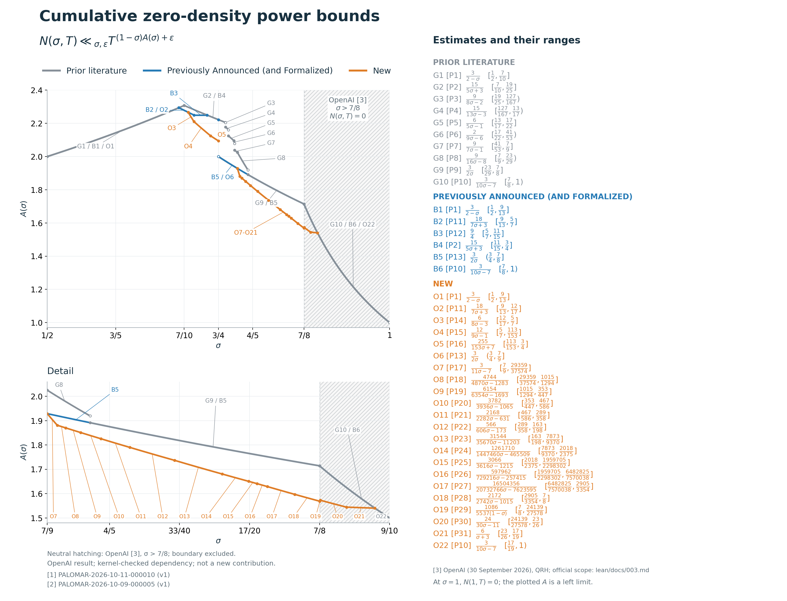

# Improved zero-density estimates for the Riemann zeta function

We establish improved zero-density estimates for the Riemann zeta function relative to the bounds previously released in PALOMAR-2026-10-11-000010 v1 and PALOMAR-2026-10-09-000005 v1. Let N(σ,T) count the nontrivial zeros with Re ρ ≥ σ and |Im ρ| ≤ T, with analytic multiplicity. For T ≥ 2 and ε > 0, our bounds have the form N(σ,T) ≤ C(σ,ε)T^((1−σ)A(σ)+ε). The native quantitative bounds improve those earlier power curves for 12/17 < σ ≤ 3/4 and 7/9 < σ ≤ 7/8. The displayed power-curve comparison continues for 7/8 < σ < 17/19, where the imported OpenAI result already gives N(σ,T)=0. Later Lean-formalized refinements also give a zero-free region below 7/8 [Collet26]; our comparisons near 7/8 concern the named earlier results. Table 1 gives all the proved contribution curves and their full ranges, including A(σ)=12/(9σ−1) on [5/7,113/153] and A(σ)=255/(153σ+7) on [113/153,3/4]. Figure 1 compares the cumulative curves.

Prior submissions: [1] [PALOMAR-2026-10-11-000010 v1](https://palomar-registry.org/entry?id=PALOMAR-2026-10-11-000010&version=1); [2] [PALOMAR-2026-10-09-000005 v1](https://palomar-registry.org/entry?id=PALOMAR-2026-10-09-000005&version=1).

Let $N(\sigma,T)$ count nontrivial zeta zeros with $\operatorname{Re}\rho\ge\sigma$ and $|\operatorname{Im}\rho|\le T$, with analytic multiplicity. All full-density rows hold for every real $T\ge2$ and every $\varepsilon>0$.

$$N(\sigma,T)\le C T^{p(\sigma)+\varepsilon},\qquad p(\sigma)=(1-\sigma)A(\sigma).$$

**Figure 1.** The curves are cumulative minima: Prior literature (gray), Previously Announced (and Formalized) (blue), and New (orange). Coincident portions use the earlier color. The PDF figure and `ACTIVE_FRONTIERS.json` give every exact active formula and endpoint.

The plotted power curves compare the named earlier submissions; “New” denotes additions to that comparison. Hatching marks the imported OpenAI input at σ>7/8. Later zero-free refinements are cited in the text.

Segment IDs match the exact frontier key; each key entry identifies the corresponding table row P1-P31. Direct labels and leader lines identify the displayed segments. The complete mapping is in `SEGMENT_TABLE_CROSSWALK.json`.

**External zero-free region [3].** OpenAI proves $N(\sigma,T)=0$ for $\sigma>7/8$; the boundary is excluded. The imported proof is kernel-checked here and credited to OpenAI.

The 73 selected main statements passed protected Comparator with Lean, NanoDa and verified con-ron. The three separate-object rows retain their own Lean 4.34.1 evidence and are outside this Comparator selection.

## Table 1. Proved contribution bounds

All 21 displayed contribution curves and input consequences are retained, including weaker proved results. Full theorem ranges are shown, rather than just intervals where a curve is active. S means $C=C_{\sigma,\varepsilon}$ for fixed $\sigma$; U means one $C_\varepsilon$ works for all $\sigma$ in the range. In either case the constant is chosen before all $T\ge2$.

| ID | Formula | Full range of $\sigma$ | Constant | Attribution |
|---|---|---|---|---|
| P11 | $A = 18/(7\sigma+3)$ | $[9/13, 5/7]$ | S | Lewko, announced |
| P12 | $A = 9/4$ | $[5/7, 3/4]$ | S | Lewko, announced |
| P13 | $A = 3/(2\sigma)$ | $(3/4, 1)$ | S | Lewko, announced |
| P14 | $A = 6/(8\sigma-3)$ | $[7/10, 5/7]$ | S | Lewko, domination/native † |
| P15 | $A = 12/(9\sigma-1)$ | $[5/7, 113/153]$ | S | Lewko, new |
| P16 | $A = 255/(153\sigma+7)$ | $[113/153, 3/4]$ | S | Lewko, new |
| P17 | $A = 3/(11\sigma-7)$ | $[7/9, 29359/37574]$ | S | Lewko, new |
| P18 | $A = 4744/(4870\sigma-1283)$ | $[29359/37574, 1015/1294]$ | S | Lewko, new |
| P19 | $A = 6154/(6354\sigma-1693)$ | $[1015/1294, 353/447]$ | S | Lewko, new |
| P20 | $A = 3782/(3936\sigma-1065)$ | $[353/447, 467/586]$ | S | Lewko, new |
| P21 | $A = 2168/(2282\sigma-631)$ | $[467/586, 289/358]$ | S | Lewko, new |
| P22 | $A = 566/(606\sigma-173)$ | $[289/358, 163/198]$ | S | Lewko, new |
| P23 | $A = 31544/(35670\sigma-11203)$ | $[163/198, 7873/9370]$ | S | Lewko, new |
| P24 | $A = 1261710/(1447460\sigma-465509)$ | $[7873/9370, 2018/2375]$ | S | Lewko, new |
| P25 | $A = 3066/(3616\sigma-1215)$ | $[2018/2375, 1959705/2298302]$ | S | Lewko, new |
| P26 | $A = 597962/(729216\sigma-257415)$ | $[1959705/2298302, 6482825/7570038]$ | S | Lewko, new |
| P27 | $A = 16504356/(20732766\sigma-7623595)$ | $[6482825/7570038, 2905/3354]$ | S | Lewko, new |
| P28 | $A = 2172/(2742\sigma-1015)$ | $[2905/3354, 7/8]$ | S | Lewko, new |
| P29 | $p = 1086/5537$ | $[7/8, 1]$ | U | Lewko, monotone consequence |
| P30 | $A = 24/(30\sigma-11)$ | $[19/22, 23/26]$ | U | Lewko, native/input consequence † |
| P31 | $A = 6/(\sigma+3)$ | $[23/26, 1]$ | U | Lewko curve, zero-free consequence † |

Also proved: $A(\sigma)=39/17$ on the closed interval $[1/2,1]$, with one $C_\varepsilon$ for all $\sigma$ and $T\ge2$. This previously announced weaker estimate is off the cumulative frontier.

† The curve $A=6/(8\sigma-3)$ uses announced-bound domination on [7/10,12/17] and the native two-term argument on (12/17,5/7]. The curve $A=24/(30\sigma-11)$ uses native domination through 7/8 and OpenAI zero-freeness above it. The curve $A=6/(\sigma+3)$ on [23/26,1] is a zero-free consequence. Historical rows $A=3/(2\sigma)$ and $A=3/(10\sigma-7)$ also use zero-freeness above 7/8. All printed bounds remain unconditional.

## Historical comparisons

These are prior-literature conclusions. The present formalization establishes these comparisons using completed imported input; it does not certify every original historical analytic argument.

| ID | Formula | Full range of $\sigma$ | Constant | Attribution |
|---|---|---|---|---|
| P1 | $A = 3/(2-\sigma)$ | $[1/2, 7/10]$ | S | Ingham |
| P2 | $A = 15/(5\sigma + 3)$ | $[7/10, 19/25)$ | S | Guth–Maynard |
| P3 | $A = 9/(8\sigma - 2)$ | $[19/25, 127/167)$ | S | Ivić / TTY Table 2 |
| P4 | $A = 15/(13\sigma - 3)$ | $[127/167, 13/17)$ | S | TTY Table 2 row4 |
| P5 | $A = 6/(5\sigma - 1)$ | $[13/17, 17/22)$ | S | TTY Table 2 row5 |
| P6 | $A = 2/(9\sigma - 6)$ | $[17/22, 41/53)$ | S | TTY Table 2 row6 |
| P7 | $A = 9/(7\sigma - 1)$ | $[41/53, 7/9)$ | S | TTY Table 2 row7 |
| P8 | $A = 9/(16\sigma - 8)$ | $[7/9, 1867/2347)$ | S | TTY Table 2 row8 |
| P9 | $A = 3/(2\sigma)$ | $[23/29, 1]$ | S | Kerr Theorem 6 |
| P10 | $A = 3/(10\sigma - 7)$ | $(7/10, 1]$ | S | Published Heath-Brown |

Square brackets include endpoints; round brackets exclude them. At $\sigma=1$, $N(1,T)=0$; the plotted normalized $A$ is a left limit.

## Bounds for separate objects

These live in separate Lean 4.34.1 supplements and are not in the main 73-theorem Comparator selection. Both canonical zero subsets concern the positive closed slab T ≤ Im ρ ≤ 2T, with analytic multiplicity. They are not full-density conclusions for N(σ,T). LONG and SHORT have different sigma ranges and detector parameters, so these rows do not form a full-density assembly.

### Polynomial large values at σ = 17/20

The polynomial length N lies in the displayed closed range. Coefficients are bounded by 1; translates are arbitrary and the sample points are one-separated, with polynomial modulus at least N to the power 17/20. For each ε > 0, Cε is chosen before all physical data and real T ≥ 2.

### Positive canonical LONG zeros

For every closed [L,U] strictly inside (2243/2904,3301/4228), choose δ(U) > 0 before η, ε, σ and T. For fixed L and U, C(L,U,η,ε) is then chosen before every σ in [L,U] and every real T ≥ 2. Analytic multiplicity is retained. In particular [7/9,1561/2000] is a closed admissible interval.

### Positive canonical SHORT zeros at σ = 17/20

The detector exponent is a = 1565/2936. Choose η(ε) = min(1/16384, ε/2404) before each fixed positive smoothing δ; then choose C(δ,ε) before all real T ≥ 2. SHORT means membership in the original admissible normalized powered-polynomial family; LONG is its exact complement. Analytic multiplicity is retained.

- Polynomial count: $\#W\le C_\varepsilon T^{2817/11744+\varepsilon}$ for $T^{1565/2936}\le N\le T^{4695/5872}$.
- Positive canonical LONG count: $C_{\eta,\varepsilon}T^{395(1-\sigma)/(132(11\sigma-7))+\varepsilon}$.
- Positive canonical SHORT count at $\sigma=17/20$: $C_{\delta,\varepsilon}T^{2817/11744+\varepsilon}$.

## Appendix: source and verification

Native quantitative improvements over the power curves in PALOMAR-2026-10-11-000010 v1 and PALOMAR-2026-10-09-000005 v1 occur for 12/17 < σ ≤ 3/4 and 7/9 < σ ≤ 7/8. The displayed comparison with those earlier power curves continues for 7/8 < σ < 17/19; on that range, OpenAI [3] already gives the stronger conclusion N(σ,T)=0. Proof-route summaries and upstream notices are included with the source.

Subsequent Lean-verified refinements lower the zero-free boundary below 7/8, including Hailey Collet’s strict bound Re(s)>874861/1000000=0.874861 [Collet26]. Liu’s intermediate refinement gives B∞=0.874957019420098946… [Liu26]. Our comparison near 7/8 is with the specified earlier results and does not improve the current zero-free region.

The imported, kernel-checked input used by this formalization remains OpenAI’s strict 7/8 theorem. Collet’s result has separate public tracker verification with Lean, NanoDa and con-ron. Liu’s repository reports a strict Lean source replay using pinned external artifacts. These later results are cited as literature; they are not imported into this release’s 73-statement proof closure, and no new replay of them was run for this editorial revision.

The proof sources are unchanged from protected-checked commit `451872fbaff36e7f042b9a69b4f206b433269421`, using Lean 4.35.0-rc2 and Mathlib `065356127b1dc0016f66b7283ce0ce2c4055aa55`. On 20 October 2026, protected Comparator exited 0 after Lean, NanoDa and verified con-ron accepted the solution. This presentation revision changes no proof source or statement. Full hosted Palomar CI remains pending.

Open full-density proposals are excluded from the curve and result count. The mixed trace estimate, the short-detector saving near $39/50$, the remaining LONG range at $17/20$, and the endpoint $\sigma=3/4$ require further arguments.

### Source references

- [1] [PALOMAR-2026-10-11-000010 (v1): Zero-density estimates from an improved large-values bound](https://palomar-registry.org/entry?id=PALOMAR-2026-10-11-000010&version=1).
- [2] [PALOMAR-2026-10-09-000005 (v1): A zero-density estimate with exponent 3(1−σ)/(2σ) for the Riemann zeta function](https://palomar-registry.org/entry?id=PALOMAR-2026-10-09-000005&version=1).

- [3] OpenAI, *The Quasi-Riemann Hypothesis: A Zero-Free Half-Plane Re s > 7/8* (30 September 2026). [Official scope](https://github.com/openai/math/blob/main/lean/docs/003.md).

- [Liu26] Baiying Liu, Improved zero-free half-planes for the quasi-Riemann hypothesis, arXiv:2610.12234v2 (12 October 2026). https://arxiv.org/abs/2610.12234v2 [Lean source](https://github.com/liubaiying101/Improved-zero-free-half-planes-for-the-quasi-Riemann-hypothesis/blob/46d612c2b63a163665ef560afca1965f7c8f434b/PartIV.lean); [reported verification scope](https://github.com/liubaiying101/Improved-zero-free-half-planes-for-the-quasi-Riemann-hypothesis/blob/46d612c2b63a163665ef560afca1965f7c8f434b/README_on_lean.md).

- [Collet26] Hailey Collet, A zero-free half-plane with boundary 874861/1000000. https://haileystorm.github.io/research/cycle61-qrh-boundary/ [Tracker certificate](https://gtimg.github.io/QuasiRiemannTracker/certificates/cycle61-c0125139.json); [public verification run](https://github.com/GTimG/QuasiRiemannTracker/actions/runs/38434626063/attempts/1).

## Author and license

Mark Lewko is the project author and sole human responsible maintainer. Project material within the scope described in ../../LICENSING.md is licensed under AGPL-3.0-only; upstream licenses and notices are retained. See ../../AUTHORS.md for AI assistance and ../../VERIFICATION.json for verification scope.
